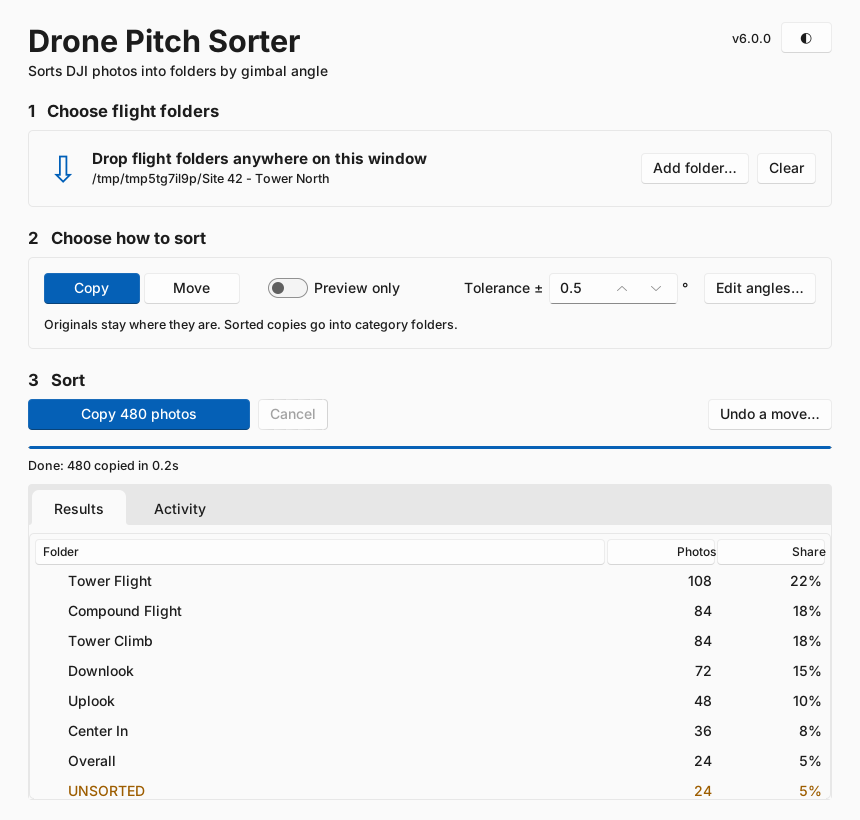

# Drone Pitch Sorter



Sorts DJI drone photos (built for the Mavic 3 Enterprise) into folders based on the
camera's **gimbal pitch**: Tower Flight, Downlook, Uplook, and so on.

**No ExifTool needed.** DJI stores the pitch as plain text inside each photo
(`drone-dji:GimbalPitchDegree="-40.00"`), so the app reads it directly. That makes it
much faster too: hundreds of photos per second instead of ~2–3.

## Download & run (Windows)

1. Go to the repo's **Releases** page and download `DronePitchSorter.exe`.
2. Double-click it. You don't need Python, ExifTool or any folder setup.
3. Drag a flight folder onto the window (or click **Add folder…**), then click the blue **Copy/Move photos** button.

Every push also builds the exe as a downloadable artifact on the **Actions** tab.

## Options

| Option | What it does |
|---|---|
| **Copy / Move** | Copy keeps the originals (default). Move puts them into the category folders. |
| **Preview only** | Shows what would happen and touches nothing. |
| **Tolerance ±°** | How close the pitch must be to a category's angle (default 0.5°). |
| **Edit angles…** | Opens `categories.json` (created next to the exe on first run). |

Photos are sorted into subfolders **inside the folder they came from**, e.g.
`Flight1/Tower Flight/DJI_0001.JPG`. Photos with no pitch, or a pitch that doesn't
match any category, go to `UNSORTED/`.

Running it again on the same folder is safe. It ignores its own output folders and
skips photos that are already sorted. If a *different* file with the same name is
already there, the new one is saved as `name_1.JPG` instead of overwriting it.

## Is Move safe?

Yes. Move is built so that a photo can't be lost:

- **Nothing is ever deleted outright.** A photo is moved by giving it a new name on the
  same drive. That's the same thing Windows does when you drag a file between folders.
  On drives that can't do that (some SD cards), the photo is copied, the copy is checked
  byte-for-byte, and only then is the original removed. If anything goes wrong, the
  original stays put.
- **Nothing is ever overwritten.** If a different photo with the same name is already
  there, the new one is saved as `name_1.JPG`. If an *identical* one is already there,
  the original is left where it was.
- **You can undo it.** Every real sort saves a `Sort log <date>.csv` in the flight folder,
  listing where each photo went. Click **Undo a move…**, pick that log, and every moved
  photo goes back to where it came from.

These rules are covered by automated tests (`tests/test_move_safety.py`) that simulate
name clashes, a disk-full error mid-copy, and drives without link support.

## Editing categories

`categories.json`:

```json
{
  "tolerance": 0.5,
  "categories": [
    { "name": "Tower Flight", "pitch": -40 },
    { "name": "Uplook", "pitch": 20 },
    { "name": "Wide band example", "min": -30, "max": -10 }
  ]
}
```

Each entry uses either `pitch` (± tolerance; add `"tolerance"` to override it for that
entry) or an explicit `min`/`max`. The first match wins, and several entries can share a
name (like the two "Compound Flight" angles).

## Running from source

```bash
pip install -r requirements.txt   # optional, enables drag & drop
python main.py                    # opens the app
python main.py "D:\Flights\Site 42" --dry-run   # command-line mode
python -m pytest                  # tests
```

## Publishing a new version

```bash
git tag v6.0.0
git push origin v6.0.0
```

GitHub Actions runs the tests, builds `DronePitchSorter.exe` and attaches it to a new Release.
